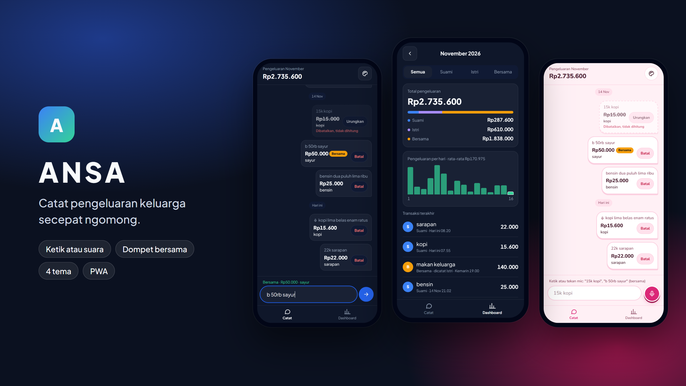
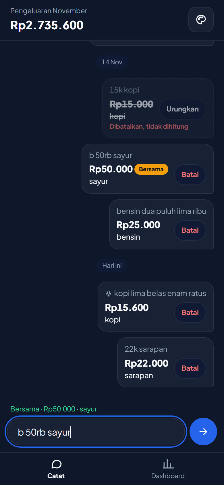
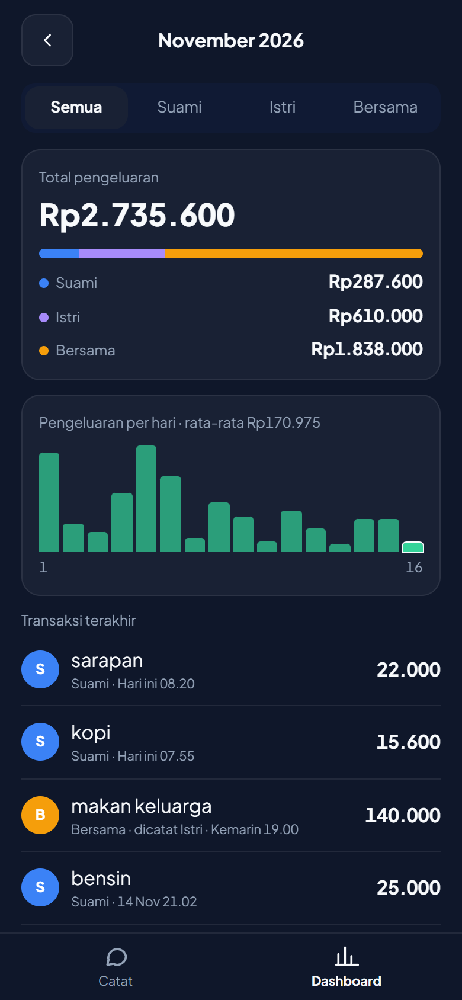
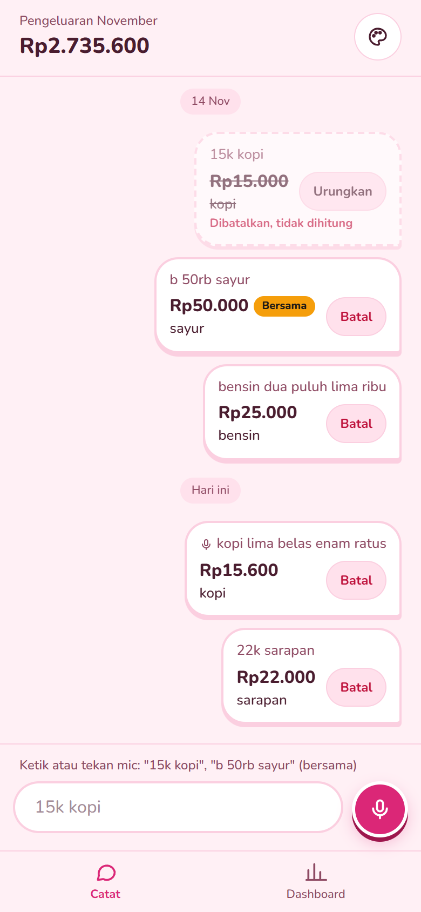
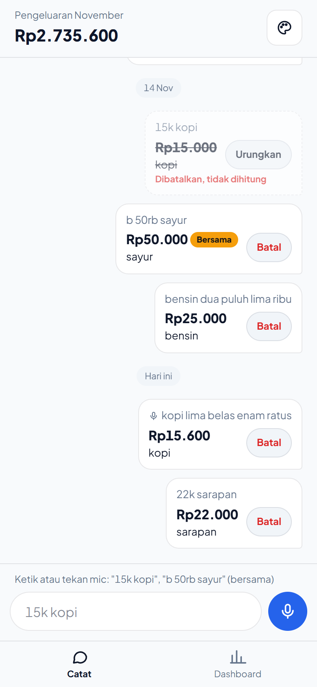
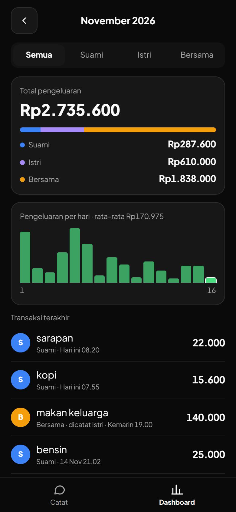
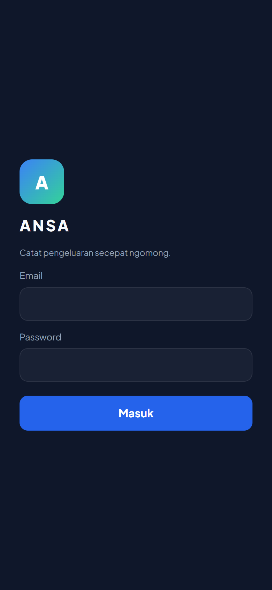

<div align="center">


# ANSA

**Catat pengeluaran keluarga secepat ngomong.**

Buka di HP, ketik atau ucapkan `15k kopi` atau `b 50rb sayur`, selesai.<br/>
Suami dan istri punya akun sendiri, tapi dompetnya satu.

    



</div>

---

## ✨ Fitur

| Fitur | Keterangan |
|---|---|
| 💬 **Catat gaya chat** | Ketik `15k kopi`, langsung jadi Rp15.000 dengan pratinjau sebelum dikirim. |
| 🎙️ **Cukup ngomong** | Tekan mic, bilang *"lima belas enam ratus kopi"*, tercatat Rp15.600. |
| 👨‍👩‍👧 **Dompet bersama** | Akun suami & istri terpisah, dashboard gabungan. Awali `b` / `belanja` untuk pengeluaran **Bersama**. |
| ↩️ **Batal & Urungkan** | Salah catat? Batal satu ketuk, total langsung kembali. Salah pencet? Urungkan. |
| 📊 **Dashboard bulanan** | Total, porsi Suami/Istri/Bersama, grafik per hari, saring per pemilik. |
| 🎨 **4 tema** | Navy, Gelap, Terang, dan Pink yang tombolnya bulat membal. |
| 📱 **Seperti aplikasi** | Pasang ke layar utama HP (PWA), tanpa Play Store / App Store. |

## 📸 Tampilan

<table>
  <tr>
    <td align="center"><br/><sub><b>Catat</b> · pratinjau saat mengetik</sub></td>
    <td align="center"><br/><sub><b>Dashboard</b> · tema Navy</sub></td>
    <td align="center"><br/><sub><b>Catat</b> · tema Pink</sub></td>
  </tr>
  <tr>
    <td align="center"><br/><sub><b>Catat</b> · tema Terang</sub></td>
    <td align="center"><br/><sub><b>Dashboard</b> · tema Gelap</sub></td>
    <td align="center"><br/><sub><b>Masuk</b></sub></td>
  </tr>
</table>

<sub>Semua data di gambar adalah data rekaan.</sub>

## 🗣️ Cara pakai

| Ketik / ucapkan | Tercatat |
|---|---|
| `15k kopi`, `15rb kopi`, `15 ribu kopi`, `15.000 kopi` | Rp15.000, catatan "kopi" |
| `15` (angka di bawah 1.000 tanpa satuan) | Rp15.000 (dianggap ribuan) |
| `lima belas ribu`, `bensin dua puluh lima ribu` | Rp15.000 / Rp25.000 (catatan boleh di depan) |
| `lima belas enam ratus` | Rp15.600 |
| `1,5jt kontrakan`, `satu setengah juta`, `sejuta lima ratus ribu` | Rp1.500.000 |
| `b 50rb sayur`, `belanja 50.000 sayur` | **Bersama** Rp50.000 (bukan milik suami/istri) |

- Tombol **mic**: tekan, ucapkan nominal + catatan, otomatis tercatat.
- Tombol **Batal** di tiap catatan: tidak dihitung lagi. Salah pencet? Tekan **Urungkan**.
- Tombol **palet** di kanan atas: ganti tema (Navy, Gelap, Terang, Pink).
- **Dashboard**: total bulan ini, porsi Suami/Istri/Bersama, grafik per hari, transaksi terakhir.

---

## 🚀 Pasang dari nol (sekali saja, ±30 menit)

Setiap keluarga memasang ANSA miliknya sendiri: database, akun, dan alamat web sendiri. Data kamu tidak tercampur
dengan pemakai lain, dan pemilik repo ini tidak bisa melihatnya.

Yang dibutuhkan:

- Laptop (Windows, macOS, atau Linux) dengan [Node.js](https://nodejs.org) 24 (LTS) atau lebih baru dan
  [Git](https://git-scm.com).
- Akun [GitHub](https://github.com). Neon dan Vercel bisa didaftar pakai akun GitHub yang sama.

Semua layanan di bawah ini gratis. Ringkasnya ada 5 tahap:

1. **GitHub**: salin (fork) kode ANSA ke akunmu, lalu unduh ke laptop.
2. **Neon**: tempat menyimpan data.
3. **Laptop**: isi pengaturan, buat tabel dan akun.
4. **Vercel**: membuat ANSA bisa dibuka dari internet.
5. **HP**: pasang ke layar utama.

Perintah di bawah ditulis untuk **PowerShell** (Windows). Di macOS/Linux pakai **Terminal**; perintah yang beda
ditandai.

### 1️⃣ Tahap 1 — Kode dari GitHub

1. Buka https://github.com/anggafestiyan1/ANSA, klik **Fork** → **Create fork**.
   Sekarang ada salinan di akunmu: `https://github.com/<akun-kamu>/ANSA`. Boleh dibuat Private
   (**Settings → General → Danger Zone → Change visibility**).
2. Unduh ke laptop (ganti `<akun-kamu>`), lalu masuk ke foldernya:

   ```powershell
   git clone https://github.com/<akun-kamu>/ANSA.git
   cd ANSA
   ```

Pemilik repo yang sudah punya kodenya di laptop: lewati tahap ini.

### 2️⃣ Tahap 2 — Database di Neon

1. Buka https://neon.tech, lalu **Sign up** (pakai Google atau GitHub).
2. Klik **Create project**:
   - Project name: `ANSA`
   - Region: **AWS Asia Pacific (Singapore)**
   - Klik **Create**.
3. Di halaman project, klik tombol **Connect**.
4. Nyalakan **Connection pooling**. Salin teks yang muncul (diawali `postgresql://`, ada kata `-pooler`).
   Ini **connection string**: kunci masuk ke database. Jangan dibagikan ke siapa pun.

### 3️⃣ Tahap 3 — Pengaturan di laptop

Buka **PowerShell** di folder ANSA (hasil Tahap 1), lalu jalankan satu per satu:

1. Pasang paket:

   ```powershell
   npm install
   ```

2. Buat file pengaturan dari contohnya (macOS/Linux: `cp .env.example .env.local`):

   ```powershell
   Copy-Item .env.example .env.local
   ```

3. Buat kunci rahasia login, lalu **salin** hasilnya (deretan huruf dan angka):

   ```powershell
   node -e "console.log(require('crypto').randomBytes(32).toString('hex'))"
   ```

4. Buka file pengaturan (macOS/Linux: `nano .env.local`):

   ```powershell
   notepad .env.local
   ```

   Isi dua baris ini (tempel di belakang tanda `=`, tanpa spasi), lalu **Save**:

   ```
   DATABASE_URL=postgresql://...connection string dari Tahap 2...
   SESSION_SECRET=...hasil langkah 3...
   ```

   `.env.local` sudah dikecualikan di `.gitignore`, jadi tidak pernah ikut ter-commit atau ter-push ke GitHub.
   Jangan menulis connection string atau kunci rahasia di file lain.

5. Buat tabel di database. Berhasil kalau muncul `Skema siap.`:

   ```powershell
   npm run db:migrate
   ```

6. Buat akun. Jalankan **dua kali**: sekali untuk suami, sekali untuk istri.

   ```powershell
   npm run user:create
   ```

   Isi nama tampilan (mis. `Suami`), email, dan password (minimal 8 karakter, tidak terlihat saat diketik).
   Lupa password? Jalankan perintah ini lagi dengan email yang sama: password-nya diganti.

7. (Opsional) Coba di laptop dulu:

   ```powershell
   npm run dev
   ```

   Buka http://localhost:3000, login, coba catat. Tekan `Ctrl+C` di PowerShell untuk berhenti.

### 4️⃣ Tahap 4 — Online di Vercel

1. Buka https://vercel.com, lalu **Sign up** pakai **GitHub**.
2. Klik **Add New… → Project**, cari repo `ANSA` milikmu (hasil fork), klik **Import**.
3. Buka bagian **Environment Variables**, tambahkan dua baris, isinya sama persis dengan `.env.local`:

   | Key | Value |
   |---|---|
   | `DATABASE_URL` | connection string Neon |
   | `SESSION_SECRET` | kunci rahasia dari Tahap 3 |

4. Klik **Deploy**, tunggu 1–2 menit sampai muncul "Congratulations".
5. Supaya cepat dari Indonesia: **Settings → Functions → Function Region** → pilih **Singapore (sin1)** → Save.
   Lalu **Deployments** → titik tiga di deployment teratas → **Redeploy**.
6. Alamat ANSA ada di halaman project, mis. `https://ansa-xxxx.vercel.app`. Kirim alamat ini ke pasangan.

Setiap ada perubahan kode yang di-push ke branch `develop`, Vercel otomatis memperbarui ANSA.

### 5️⃣ Tahap 5 — Pasang di HP

1. Buka alamat ANSA di HP, lalu login.
2. Pasang ke layar utama:
   - **Android (Chrome)**: menu **⋮** → **Install app** atau **Add to Home screen**.
   - **iPhone (Safari)**: tombol **Share** (kotak dengan panah) → **Add to Home Screen**.
3. Pertama kali tekan tombol mic, pilih **Izinkan** untuk mikrofon.
   Mic tidak tersedia di Firefox; ketik tetap bisa.

---

## 🧯 Kalau ada masalah

| Gejala | Penyebab / solusi |
|---|---|
| `DATABASE_URL belum diisi di .env.local` | File belum dibuat atau baris kosong. Ulangi Tahap 3 langkah 2–4. |
| `password authentication failed` / `getaddrinfo` | Connection string salah salin. Salin ulang dari Neon (Tahap 2 langkah 3–4). |
| Halaman Vercel error 500 setelah deploy | Environment Variables belum diisi atau salah. Perbaiki di Vercel → Settings → Environment Variables, lalu Redeploy. |
| `SESSION_SECRET belum diisi` | Isi `SESSION_SECRET` (minimal 32 karakter) di `.env.local` dan di Vercel. |
| Lupa password | `npm run user:create` dengan email yang sama. |
| Ingin semua HP keluar (mis. HP hilang) | Ganti `SESSION_SECRET` di Vercel, lalu Redeploy. Semua perangkat harus login ulang. |
| Tombol mic tidak muncul | Browser tidak mendukung suara (mis. Firefox). Pakai Chrome atau Safari. |

---

## 🛠️ Untuk developer

Stack: Next.js 16 (App Router) + TypeScript, PostgreSQL lewat `pg` (SQL langsung), Vitest.

| Path | Isi |
|---|---|
| `lib/parse.ts` | Membaca input ketik/suara jadi nominal + catatan + Bersama |
| `lib/expenses.ts` | Semua query pengeluaran (catat, batal, total, dashboard) |
| `lib/session.ts`, `lib/token.ts` | Sesi login: cookie httpOnly bertanda tangan HMAC |
| `lib/password.ts` | Hash password scrypt |
| `lib/month.ts` | Bulan/hari dalam jam Asia/Jakarta |
| `app/(app)/` | Layar Catat (`/`) dan Dashboard (`/dashboard`) |
| `app/login/` | Login dan logout |
| `db/schema.sql` | Skema database (aman dijalankan ulang) |
| `scripts/` | `migrate.mts` (buat tabel), `create-user.mts` (buat akun / ganti password) |

Tes:

- `npm test`: unit test (parser, token, password, bulan).
- Uji integrasi database ikut jalan kalau `TEST_DATABASE_URL` diisi; memakai schema sementara lalu dihapus:
  `TEST_DATABASE_URL=postgres://... npm test`
